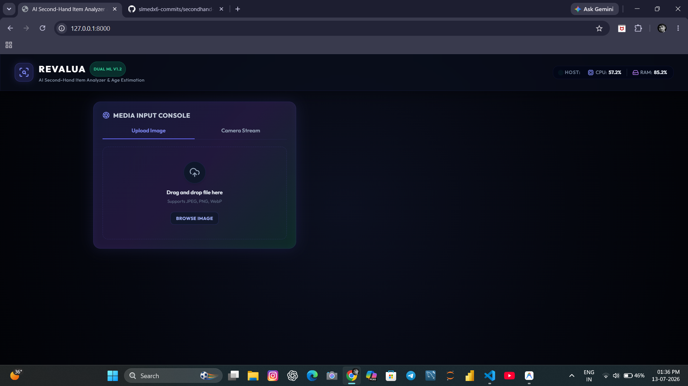
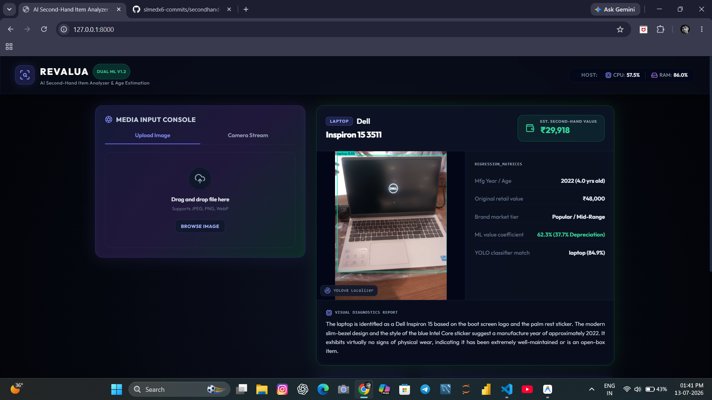

# AI Second-Hand Item Analyzer & Age Estimation

A hybrid, resource-optimized web application designed to run on consumer hardware (Intel Core i3, 8GB RAM, No GPU) under Windows. It inspects second-hand objects, detects physical wear, estimates age, and predicts residual price in Indian Rupees (₹) using a combination of local CPU models (YOLOv8 + scikit-learn RandomForestRegressor) and cloud visual appraisal (Gemini 3.5 Flash).

---

## 📸 Application Preview

| Futuristic Dashboard (Idle) | Appraisal & Analysis Results |
| :---: | :---: |
|  |  |

---

## 🛠️ Technology Stack & Machine Learning Pipelines

1. **Local Object Detection (YOLOv8-nano)**: Detects, highlights, and localizes the item in system memory, returning bounding-box annotated frames.
2. **Local Price Prediction (scikit-learn)**: A tabular Random Forest Regressor trained on synthetic transaction statistics that predicts depreciation ratios based on category, age, brand tier, and visual wear.
3. **Cloud Visual Inspection (Gemini 3.5 Flash)**: Pinpoints brand/model, estimated release year, details visual wear (scratches, dents, cracks, rust), and generates natural language reasoning.
4. **FastAPI Backend & Tailwind CSS UI**: Lightweight async service and responsive, glassmorphic dashboard.

---

## ⚙️ Project Structure

```text
secondhand-analyzer/
├── backend/
│   ├── __init__.py
│   ├── app.py            # FastAPI service endpoints
│   ├── analyzer.py       # YOLOv8 + Gemini + tabular pricing pipeline
│   ├── train_model.py    # Training & evaluation pipeline for pricing Regressor
│   └── price_model.joblib # Serialized RandomForestRegressor pipeline
├── frontend/
│   └── index.html        # Glassmorphic client UI
├── requirements.txt      # Optimized libraries for Windows CPU
├── .env.example          # Environment variables template
└── README.md             # This guide
```

---

## 🚀 Quick Start on Localhost (1-Click Run)

The application is heavily optimized to run on **your own localhost server** using consumer or low-end hardware (2GB–4GB RAM, dual-core CPUs) without freezing or crashing when multiple users open it.

### Option 1: 1-Click Launchers
- **Windows:** Double-click [`run.bat`](file:///C:/Users/Slmed/.gemini/antigravity/scratch/secondhand-analyzer/run.bat)
- **Linux / macOS:** Run `./run.sh` (or `bash run.sh`)
- **Direct Terminal:** Run `python run.py`

This will automatically:
1. Bind to an open port (default `8000`).
2. Detect your local Wi-Fi IP so other devices (e.g. your smartphone) on your network can access it (`http://<your-local-ip>:8000`).
3. Automatically open your default web browser to `http://localhost:8000`.

---

## ⚡ Low-End Device & Multi-User Crash Prevention

When many users open and scan items simultaneously, typical ML apps freeze the host CPU and cause Out-Of-Memory (OOM) crashes. This application implements 4 layers of protection:

1. **Async AnyIO Threadpool (`run_in_threadpool`):**
   - Synchronous image manipulation and model predictions are offloaded from the main asyncio event loop.
   - The server handles hundreds of concurrent connections, web visitors, and health checks without dropping a single packet.
2. **Concurrency Semaphore Queue (`asyncio.Semaphore`):**
   - Limits concurrent heavy ML inferences to your hardware's CPU capacity.
   - If 10 users upload images at the exact same second on a 2GB RAM device, requests queue safely and process in order instead of spiking RAM and crashing the server.
3. **Hardware Thread Capping:**
   - PyTorch and OpenMP are restricted to 2 CPU threads (`torch.set_num_threads(2)`, `OMP_NUM_THREADS=2`), preventing CPU pegging at 100% and keeping the host system responsive.
4. **RAM-Aware Model Initialization:**
   - If available RAM is below 450 MB, heavy model pre-warming is deferred to conserve system memory.
5. **Client-Side Image Canvas Compression:**
   - Smartphone camera photos (10MB+) are compressed in the user's browser down to ~90KB before transmission, sparing low-end localhost servers from decompressing massive bitmaps into RAM.

---

### Manual Setup (Optional)
If you prefer running step-by-step:
```powershell
# 1. Install dependencies
pip install -r requirements.txt

# 2. Run the server
python run.py
```
Open `http://localhost:8000` in your web browser.

With only 8GB of RAM, loading PyTorch dependencies and models can sometimes trigger Windows Out-Of-Memory (OOM) exceptions. To prevent system crashes, configure a virtual memory pagefile to back system memory with SSD storage:

1. Press `Win + R`, type `sysdm.cpl`, and hit Enter to open **System Properties**.
2. Go to the **Advanced** tab. Under **Performance**, click **Settings...**.
3. Go to the **Advanced** tab in Performance Options, then under **Virtual memory**, click **Change...**.
4. Uncheck **Automatically manage paging file size for all drives**.
5. Select your C: drive, select **Custom size**, and enter:
   - **Initial size**: `8192` (8 GB)
   - **Maximum size**: `16384` (16 GB)
6. Click **Set**, then click **OK**, and restart your computer to apply.

---

## ☁️ Free Hosting Deployment Guide

### Deployment Option A: Hugging Face Spaces (Free Tier CPU)
1. Sign in to [Hugging Face](https://huggingface.co/) and click **New Space**.
2. Select **Docker** as the SDK (FastAPI works best via Docker for custom system dependencies like YOLOv8).
3. Select **Blank** docker template.
4. Add the following `Dockerfile` to the root:
   ```dockerfile
   FROM python:3.10-slim
   RUN apt-get update && apt-get install -y libgl1 libglib2.0-0 && rm -rf /var/lib/apt/lists/*
   WORKDIR /app
   COPY requirements.txt .
   RUN pip install --no-cache-dir -r requirements.txt
   COPY . .
   RUN python backend/train_model.py
   EXPOSE 7860
   CMD ["uvicorn", "backend.app:app", "--host", "0.0.0.0", "--port", "7860"]
   ```
5. Commit files to the Space. Under Space **Settings**, add your `GEMINI_API_KEY` to **Repository secrets**.

### Deployment Option B: Streamlit Community Cloud (Migrating to Streamlit UI)
To deploy on Streamlit Community Cloud:
1. Re-implement the UI elements using streamlit functions inside `app.py`.
2. Push your project to a GitHub repository.
3. Link your GitHub repo to [Streamlit Share](https://share.streamlit.io/).
4. Add your `GEMINI_API_KEY` under the app secrets menu.
